# Justify AI

[](https://github.com/UserNawaf/justify-ai/actions/workflows/ci.yml)
[](https://github.com/UserNawaf/justify-ai/actions/workflows/prompt-eval.yml)

AI-assisted standardisation of IT request justifications (firewall rules and access requests).

Today an employee writes a free-text justification, the engineer handling the ticket can't act on it, and the
two go back and forth on Teams or email asking "what do you mean?". Justify AI sits in between:

1. the employee writes the justification their own way, in Arabic or English;
2. a Llama model reads it; **the code** works out what is missing and asks **at most 3 short questions**,
   in the employee's language;
3. the engineer receives a **fixed-format** justification with a quality score;
4. every request and every round is stored, so Power BI can show what people forget and whether quality improves.

| 1. Write it your way | 2. Answer what's missing | 3. Fixed format for the engineer |
|---|---|---|
| 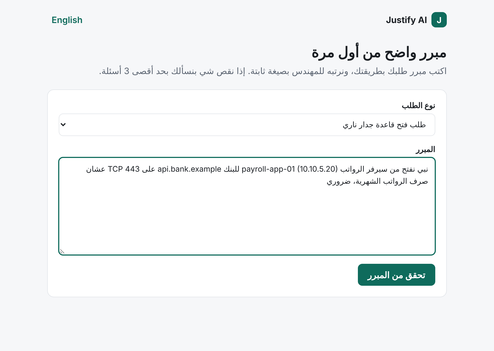 | 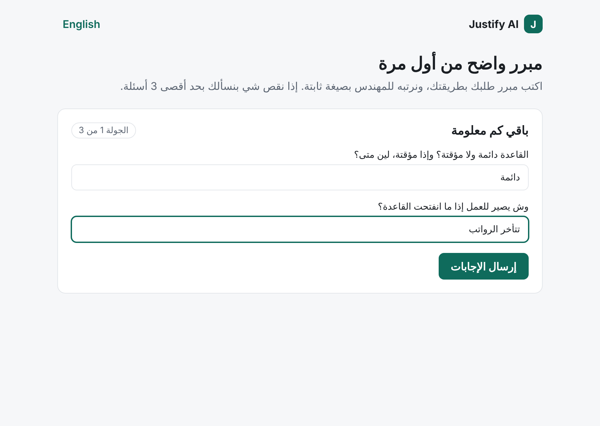 | 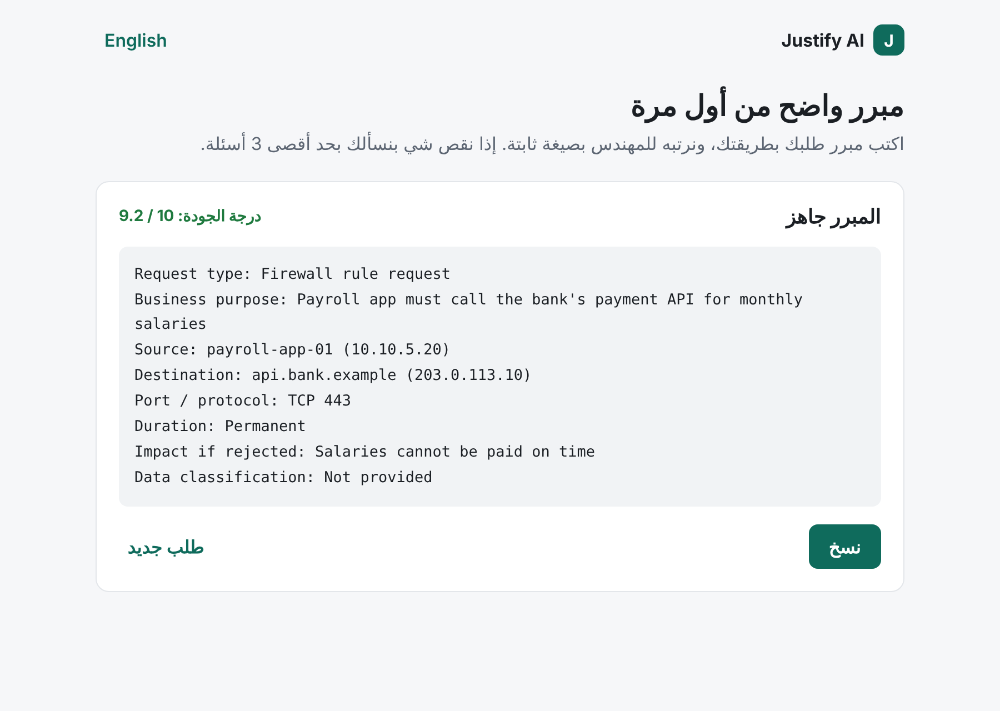 |

<details><summary>English UI</summary>

| | | |
|---|---|---|
| 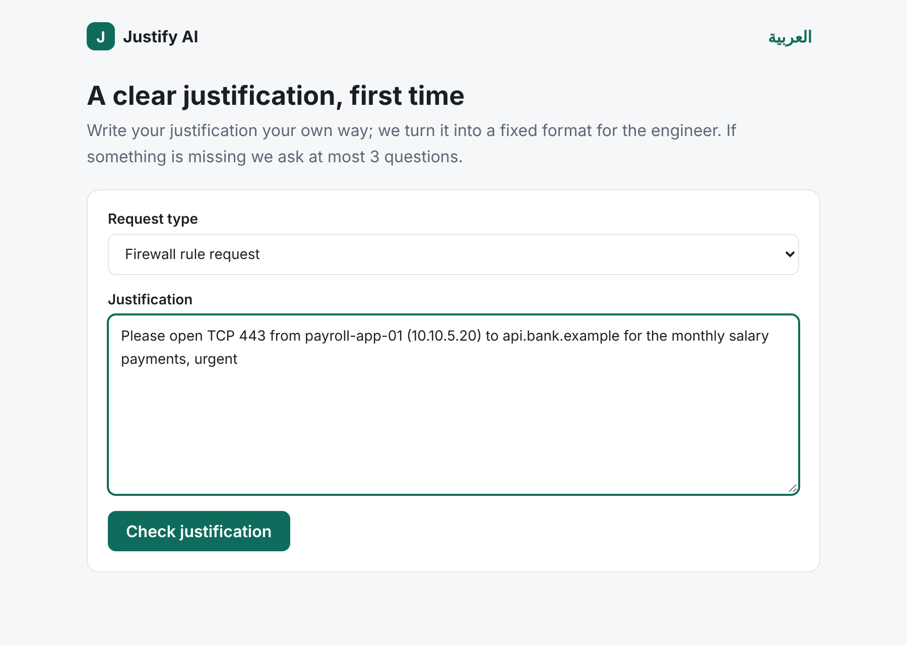 | 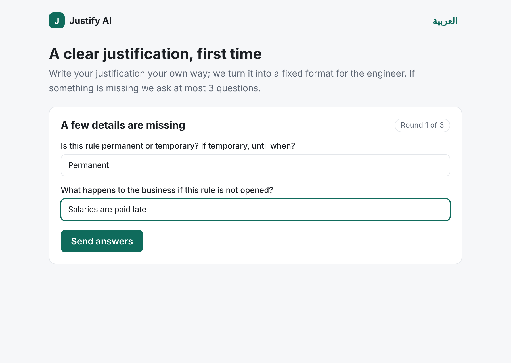 | 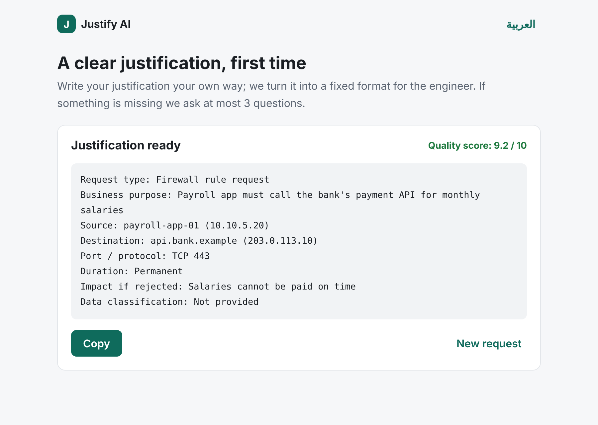 |

</details>

## Firewall Access Request portal

A complete request flow in the style of an enterprise IT service portal. The requester fills in a standard
**Firewall Access Request** (request type, priority, application, source / destination IP, port, protocol,
environment, duration, start date); **code** validates every technical field. The **Business Justification**
is free text, and **AI** checks it before it reaches the network security team, asking at most 3 short
questions if the purpose or the impact is missing. Each request gets a number (`FW-2026-00042`), lands in the
team's queue, and is approved or rejected with a note. Everything is stored and reported in Power BI.

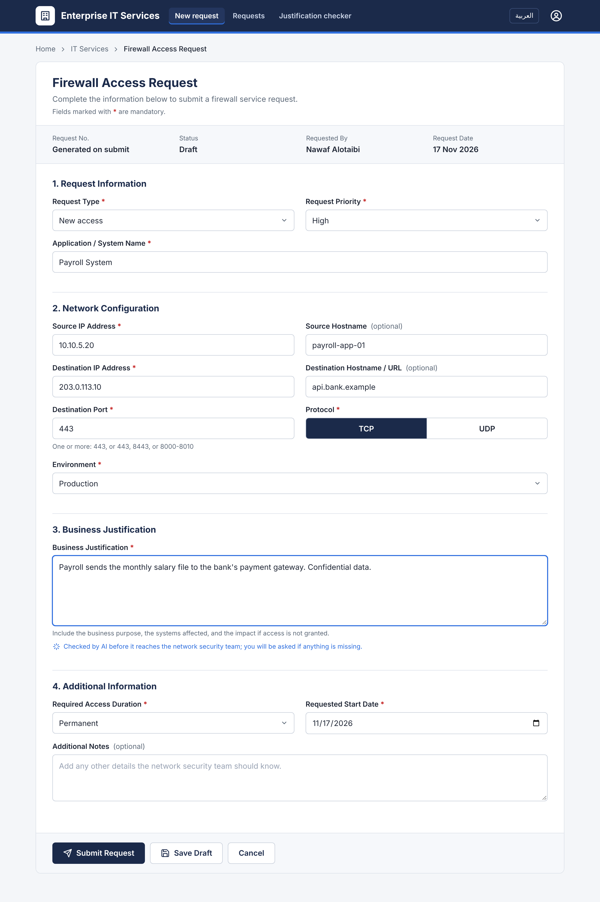

| AI asks only for what is missing | Network security queue |
|---|---|
| 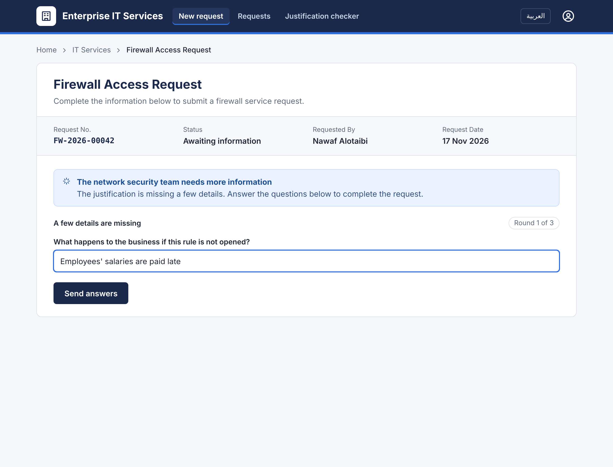 | 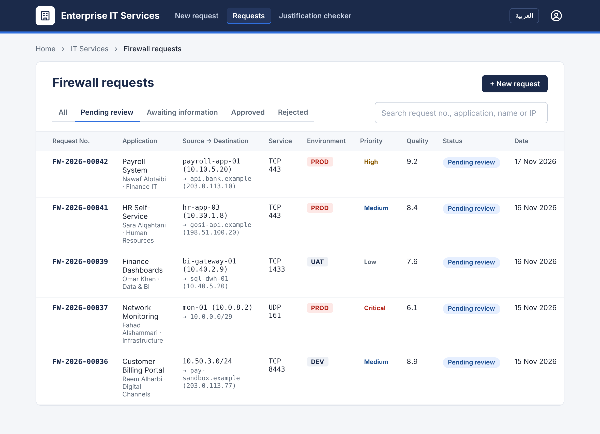 |

| Review and decide | Mobile | Arabic (RTL) |
|---|---|---|
| 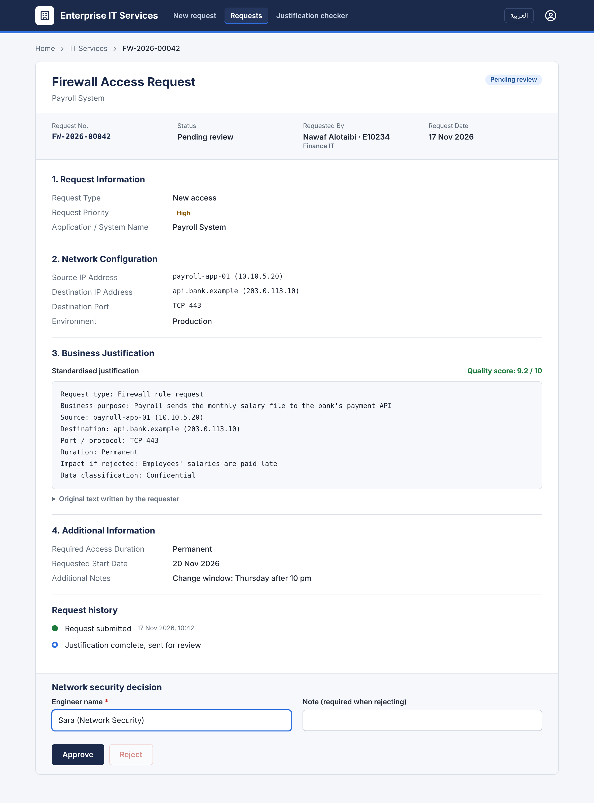 | 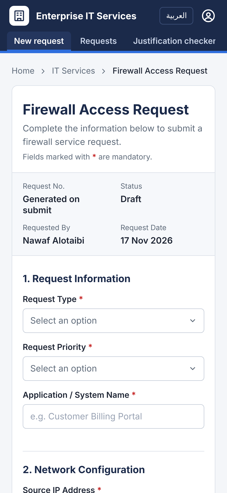 | 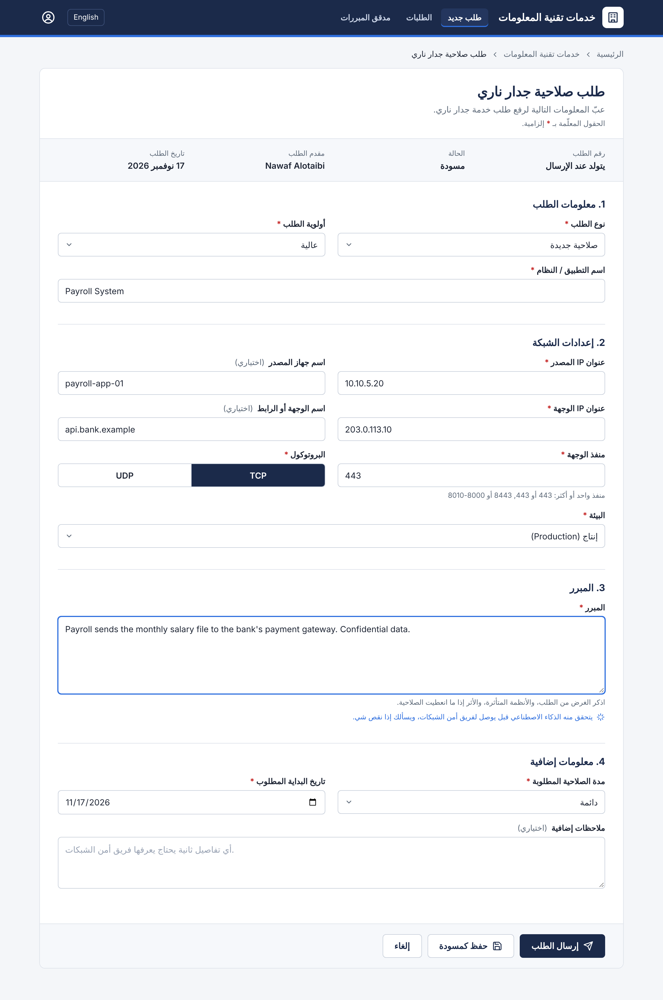 |

The form values are passed to the justification as confirmed fields, so the model never guesses an IP or a
port and the requester is never asked for something they already typed ([D26](DECISIONS.md#d26-the-portal-splits-what-code-can-check-from-what-needs-reading)).

## Justification checker

The original screen, still available: paste any free-text justification, for any request type.

It is a standalone service with a REST API, so it can be added to any workplace tool (web form, ServiceNow,
Jira, Teams) through a thin adapter, and it notifies them through a signed webhook when a justification is ready.

## Design in one line

**The model extracts, the code decides.** The LLM only reads the text into fields and rates clarity. What is
missing, which questions to ask, the status, the score and the final wording are plain, unit-tested Java
([D2](DECISIONS.md#d2-the-model-extracts-the-code-decides), [D3](DECISIONS.md#d3-standardised-text-is-rendered-by-code-not-written-by-the-model)).
Small open models are good at extraction and bad at following rules, so the split plays to their strengths and
nothing the model invents can reach the engineer's text unchecked.

## Measured, not guessed

A hand-labelled golden set (English, Arabic, mixed) runs against real models on every prompt change
([prompt-eval workflow](.github/workflows/prompt-eval.yml)). Making the prompt prefer `null` over a guess
([D21](DECISIONS.md#d21-the-prompt-prefers-null-over-a-guess)) cut invented values sharply:

| Model (local, Ollama) | Prompt v1 | Prompt v2 | Unusable replies |
|---|---|---|---|
| llama3.1:8b | 86.7% | **95.0%** | 0 |
| qwen2.5:7b | 90.0% | **98.3%** | 0 |

Field accuracy = for each required field, did the model correctly say present / missing. Details in
[docs/BACKLOG.md](docs/BACKLOG.md#prompt-evaluation-results).

## Features

- Firewall Access Request portal: enterprise form (type, priority, application, IPs, port, protocol, environment,
  duration, start date), save draft, request numbers, network security queue, approve / reject, request history
- Free text in Arabic, English or both; questions and labels localized (`Accept-Language` / `?lang=ar`)
- Request types as YAML templates, no code: firewall rule and access request bundled, more via `TEMPLATES_DIR`
- Max 3 questions per round, max 3 rounds, then `INCOMPLETE` instead of blocking the employee
- Quality score: 60% completeness (code) + 40% clarity (model)
- Idempotent per source system (`source` + `externalRef`), optimistic locking against concurrent answers
- Signed outbound webhook (HMAC-SHA256) when a justification is finished
- Engineer feedback ("was this enough?") to validate the score against reality
- Power BI: `reporting` views behind a read-only login that cannot touch the tables
- Model choice: local Llama via Ollama (default, data stays on the machine) or Groq (cloud, dummy data only)
- RFC 9457 errors, OpenAPI / Swagger UI, health probes, optional API key

## Stack

Java 21 · Spring Boot 3.5 · PostgreSQL 16 (JSONB, Flyway) · Llama via Ollama or Groq · React 19 + Vite +
TypeScript (isolated frontend, nginx) · Docker Compose · JUnit 5, Mockito, Testcontainers, Vitest ·
GitHub Actions

## Run it

Requires Docker.

```bash
cp .env.example .env          # set the passwords
docker compose up --build     # first run downloads the model (~5 GB), be patient
```

| | URL |
|---|---|
| Web app | http://localhost:8081 |
| API + Swagger UI | http://localhost:8080/swagger-ui.html |
| PostgreSQL (Power BI) | localhost:5432, database `justify`, user `powerbi_reader` |

No GPU or 5 GB to spare? Set `AI_PROVIDER=groq` and `GROQ_API_KEY` in `.env` (dummy data only) and remove the
`ollama-pull` dependency from the `backend` service.

### Try the API

```bash
curl -s localhost:8080/api/v1/justifications -H 'Content-Type: application/json' -H 'Accept-Language: ar' \
  -d '{"templateId":"firewall-rule","text":"Please open port 443 from the payroll server to the bank, urgent"}'
# -> 201, status NEEDS_INFO + questions in Arabic, e.g. "القاعدة دائمة ولا مؤقتة؟"

curl -s localhost:8080/api/v1/justifications/<id>/answers -H 'Content-Type: application/json' \
  -d '{"answers":{"duration":"Permanent","impact_if_rejected":"Salaries are paid late"}}'
# -> status COMPLETE + standardizedText + qualityScore

curl -s localhost:8080/api/v1/firewall-requests -H 'Content-Type: application/json' -d '{
  "requesterName":"Nawaf","employeeId":"E10234","department":"Finance IT",
  "requestType":"NEW_ACCESS","priority":"HIGH","applicationName":"Payroll System",
  "sourceIp":"10.10.5.20","destinationIp":"203.0.113.10","ports":"443","protocol":"TCP",
  "environment":"PRODUCTION","durationType":"PERMANENT","startDate":"2026-11-20",
  "justification":"Payroll sends the monthly salary file to the bank"}'
# -> 201, ticketNo FW-2026-00001, status AWAITING_INFO, and only the "why" is asked (impact if rejected)

curl -s localhost:8080/api/v1/justifications/<id>/feedback -H 'Content-Type: application/json' \
  -d '{"sufficient":true}'
# -> the engineer's verdict, shown in Power BI next to the score
```

### Deploy a demo (Render, free tier)

[`render.yaml`](render.yaml) creates PostgreSQL, the API (on Groq) and the web app in one go:
Render dashboard → **New → Blueprint** → pick this repo → paste a Groq API key when asked. Flyway builds the
schema on the first start. Free instances sleep when idle, so the first request takes about a minute.

### Develop without Docker

```bash
# PostgreSQL on localhost:5432 (db/user/password: justify) and Ollama on localhost:11434
ollama pull llama3.1:8b
cd backend && mvn spring-boot:run
cd frontend && npm install && npm run dev      # http://localhost:5173, proxies /api to :8080
```

## Repository

```
backend/     Spring Boot service (see docs/ARCHITECTURE.md; use cases and diagrams in docs/DESIGN.md)
frontend/    React app, isolated: talks to the API only, own container
db/init/     one-time database setup (Power BI read-only login)
templates/   extra request-type templates, loaded at start-up (no code needed)
docs/        ARCHITECTURE · TESTING · POWERBI · BACKLOG (Jira-ready) · images
DECISIONS.md every decision taken while building, and why
render.yaml  one-click demo deployment
```

## Configuration

Environment variables (defaults in `backend/src/main/resources/application.yml`):

| Variable | Default | Purpose |
|---|---|---|
| `DB_URL` (or `DB_HOST`, `DB_PORT`, `DB_NAME`), `DB_USER`, `DB_PASSWORD` | local `justify` DB | Database |
| `AI_PROVIDER` | `ollama` | `ollama` (local) or `groq` (cloud, dummy data only, see D18) |
| `OLLAMA_URL`, `OLLAMA_MODEL` | `http://localhost:11434`, `llama3.1:8b` | Local model |
| `GROQ_API_KEY`, `GROQ_MODEL` | empty, `llama-3.3-70b-versatile` | Groq model (only with `AI_PROVIDER=groq`) |
| `AI_TIMEOUT` | `120s` | Read timeout for one model call |
| `TEMPLATES_DIR` | empty | Folder with extra `*.yml` templates |
| `WEBHOOK_URL`, `WEBHOOK_SECRET` | empty (off) | POST a signed event when a submission is finished |
| `APP_API_KEY` | empty (off) | Shared secret for server-to-server callers (`X-API-Key`) |
| `CORS_ORIGINS` | `http://localhost:5173` | Only needed if a browser calls the API from another origin |
| `POWERBI_READER_PASSWORD` | empty | Creates the read-only Power BI login on first start |
| `PORT` | `8080` | HTTP port |

## Status

**Verified on every push (GitHub Actions)**
- Backend `mvn verify`: 54 unit tests and 10 integration tests on real PostgreSQL 16 (Testcontainers): full
  flow in both templates and both languages, idempotent retry, 409 on closed submissions, 503 with nothing
  stored, webhook delivered and signed, engineer feedback, the firewall portal from form to approval,
  reporting views, Power BI login refused on raw tables.
- Frontend: 9 component tests (Vitest + Testing Library: required fields, submit → AI question → submitted,
  server field errors, save draft, queue and approval, duration presets, checker flow) and production build.
- Prompt evaluation against real local models whenever the prompt or golden set changes.

**Not yet run**: the full `docker compose up` stack and the Render blueprint on a real machine / account.

**Before using real company data**: get the security team's approval, especially for storing IP addresses
and hostnames, and never send real data to Groq without it.

How it was built: designed and specified first ([DECISIONS.md](DECISIONS.md), [docs/](docs)), then
implemented with an AI coding agent and verified by the test suites above. Next steps: [docs/BACKLOG.md](docs/BACKLOG.md).
