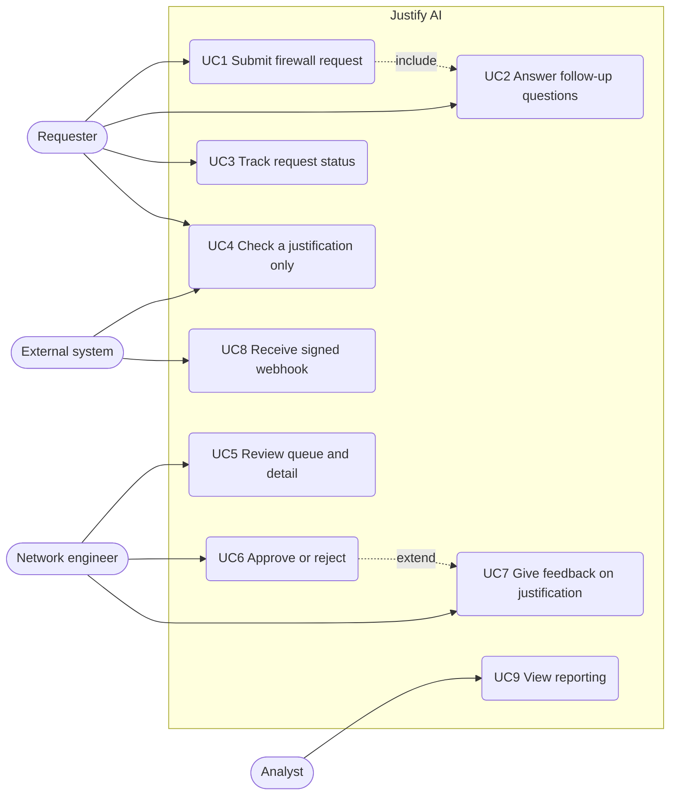
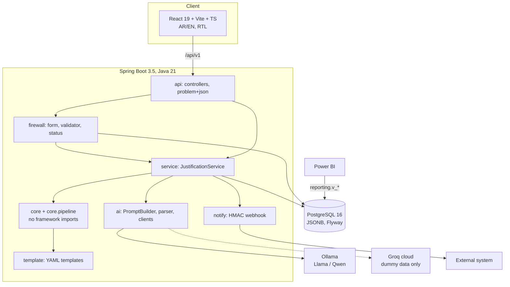
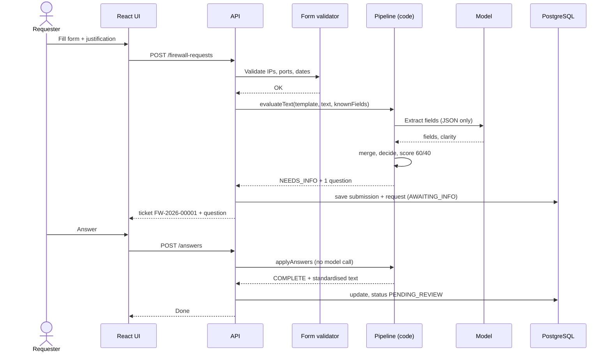
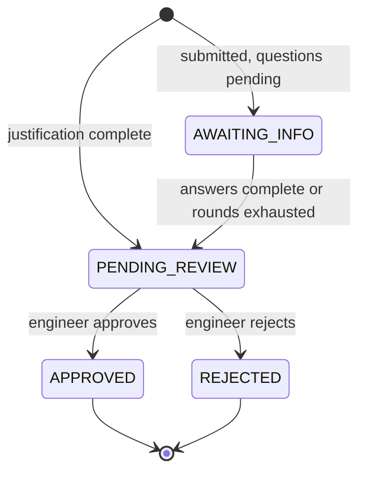
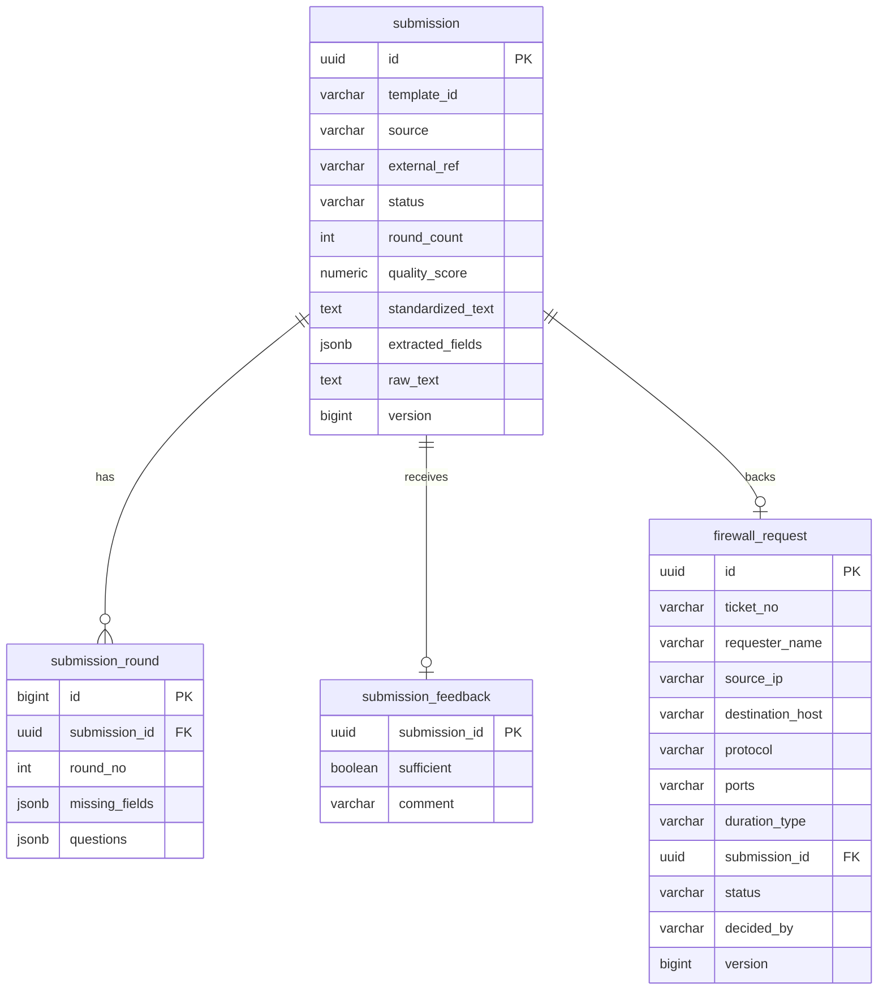
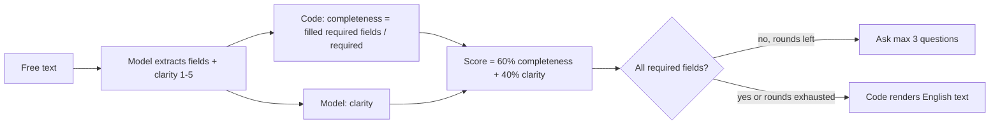

# Design: use cases and diagrams

All diagrams are Mermaid, so GitHub renders them directly.

## 1. Actors

| Actor | Who | Goal |
|---|---|---|
| Requester | Employee who needs network access | Submit a firewall request without being bounced back for details |
| Network engineer | Reviews and decides requests | Receive complete, standardised requests and approve or reject quickly |
| External system | Any ticketing or portal system calling the API | Use the justification checker as a service (`source` + `externalRef`) |
| Analyst | Reads Power BI | Measure quality and turnaround through `reporting.v_*` views |
| AI model | Ollama (local) or Groq (cloud, dummy data only) | Extract fields from free text; score clarity |

## 2. Use cases

| ID | Use case | Main flow | Alternative / error flows |
|---|---|---|---|
| UC1 | Submit firewall request | Requester fills the form; code validates technical fields; the justification is checked; a ticket `FW-YYYY-NNNNN` is created | Invalid IP/CIDR, `/0`, bad ports, temporary request over 365 days: field-level errors (RFC 9457) |
| UC2 | Answer follow-up questions | System asks at most 3 questions per round, up to 3 rounds; answers are trusted without a model call | After round 3 the request goes to review as INCOMPLETE |
| UC3 | Track request status | Requester opens the ticket and sees AWAITING_INFO, PENDING_REVIEW, APPROVED or REJECTED | Unknown ticket: 404 problem+json |
| UC4 | Check a justification only | Free text goes in; structured fields, score and standardised English text come out | Retry with the same `source` + `externalRef` returns the same result (idempotent) |
| UC5 | Review queue and detail | Engineer sees the queue with score and standardised text next to the raw text | None |
| UC6 | Approve or reject | Engineer decides with a note; status changes; completion listener fires | Concurrent decision: optimistic lock conflict (409) |
| UC7 | Give feedback | Engineer marks the justification sufficient or not | Feeds `reporting.v_feedback` to validate the score |
| UC8 | Receive signed webhook | External system gets a POST with an `X-Justify-Signature` HMAC | Failure: retries after 2s, 10s, 30s |
| UC9 | View reporting | Power BI reads `reporting.v_*` through the read-only `powerbi_reader` role | None |

## 3. Architecture

## 4. Sequence: submit a request with a vague justification

The model call happens outside the database transaction (D15), so a slow model never holds a connection.

## 5. Request status

## 6. Data model

`UNIQUE (source, external_ref)` on `submission` makes retries idempotent (D14).

## 7. Scoring

